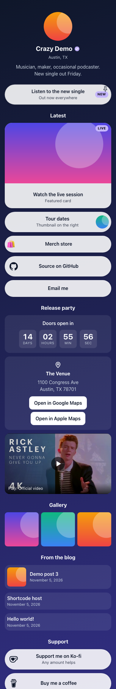
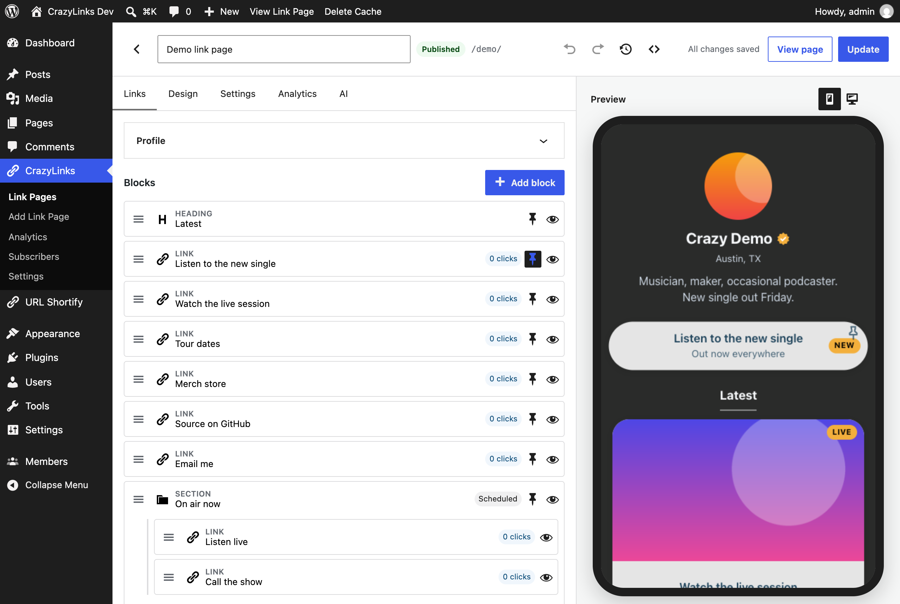
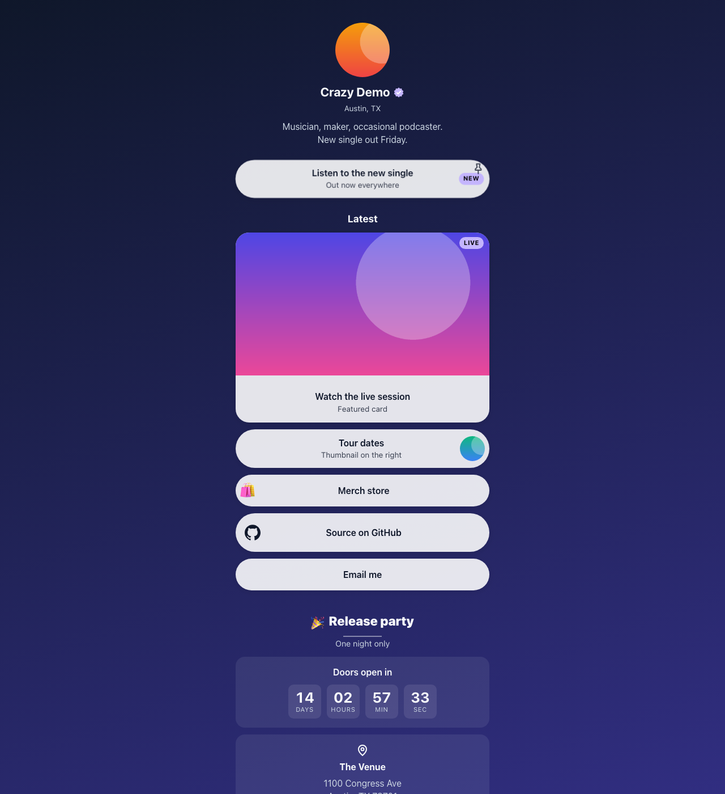

# CrazyLinks

Self-hosted link-in-bio pages for WordPress. CrazyLinks is a plugin that replaces Linktree and similar services with a page on your own domain (`yoursite.com/l/your-page`), your own database and no monthly fee. There is no account to create and no external service to depend on.



## Features

- **Blocks.** Profile header, links (button, thumbnail or image card, with subtitle, badge, NEW flag, pin), social icons for 37 networks, heading, text, divider, image, gallery, latest posts, video, email capture, contact card, countdown, map link, payment buttons, spacer and custom HTML for administrators.
- **Sections.** Styled containers that group blocks, can be collapsible, and carry their own background, padding and heading.
- **Weekly schedules.** Show or hide any block or Section on chosen days and times in the site's timezone, or within a date range.
- **14 themes.** Light, dark, gradient, bold, pastel, mono, neon, earthy, frosted glass and patterned presets that meet WCAG AA contrast. Every colour, font, button shape and background can be overridden.
- **Analytics with privacy.** Views and clicks without cookies. The visitor hash uses a daily salt, the raw IP address is never stored, and raw events are pruned after 90 days by default.
- **Email capture.** Double opt-in by default, unsubscribe links, a Subscribers screen with CSV export, and WordPress personal-data export and erasure support.
- **AI editing.** Describe a change in plain words in the page editor. CrazyLinks shows a before/after preview and applies nothing until you confirm. It uses WordPress's AI Client and the provider you connect under Settings → Connectors. Off by default.
- **Edit from Claude Desktop or Claude Code.** Through the MCP Adapter plugin, an assistant can read, preview and save changes using your own Claude account. See [below](#edit-with-claude-desktop).
- **Fast front end.** The standalone page loads no remote scripts, styles or fonts, so it behaves well in the Instagram and TikTok in-app browsers. Pages can also be placed in a theme with a block or the `[crazylinks id="123"]` shortcode.

| Editor | Public page |
|---|---|
|  |  |

More screenshots are in [`docs/screenshots/`](docs/screenshots/).

## Requirements

- WordPress 6.9 or newer
- PHP 8.1 or newer
- For AI editing: WordPress 7.0 or newer and an AI provider plugin connected under Settings → Connectors
- For editing from Claude Desktop or Claude Code: the MCP Adapter plugin

## Install

**From a release.** Download `crazylinks-<version>.zip` from the [Releases page](https://github.com/asylumlife/CrazyLinks/releases), then in WordPress go to Plugins → Add New → Upload Plugin, or unpack it into `wp-content/plugins/`. Activate it.

**From source.** The plugin is the `crazylinks/` folder. The compiled editor bundle (`assets/build`) is committed, so a copy of the folder works without a build step. To run the development tools, see [Development](#development).

## Quick start

1. Activate the plugin, then go to CrazyLinks → Add Link Page.
2. Add blocks in the editor and publish.
3. Visit `yoursite.com/l/your-page/`. The `/l/` base can be changed in CrazyLinks → Settings.

`wp crazylinks demo` creates a sample page that uses every block.

## Edit with Claude Desktop

With the MCP Adapter plugin active, Claude Desktop or Claude Code can list your pages, read the editing guide, preview changes and save them through the same validation and revision history as the editor. Each save appears as an "AI (external)" revision, and you can require confirmation in the editor first. The model runs on your Claude account, so the site needs no AI provider key for this.

Setup steps (abilities to enable, a dedicated user with an Application Password, and the connection snippet) are in [`crazylinks/docs/mcp.md`](crazylinks/docs/mcp.md).

## Development

```sh
cd crazylinks
composer install
npm ci
```

Quality gates, all run from `crazylinks/`:

```sh
vendor/bin/phpcs                       # WordPress-Extra and WordPress-Docs
vendor/bin/phpstan analyse --no-progress   # level 6
vendor/bin/phpunit                     # needs the WordPress test library
npm run typecheck
npm run lint:js
npm run lint:css
npm run test:unit                      # Vitest
npm run build                          # rebuilds assets/build, which is committed
npm run test:e2e                       # Playwright, needs a running dev site
```

The suite currently has 468 PHPUnit tests, 216 Vitest tests and 5 Playwright tests. [`docs/DEV-ENVIRONMENT.md`](docs/DEV-ENVIRONMENT.md) describes the local site and the WordPress test library setup (`crazylinks/bin/install-wp-tests.sh`). The product and technical specification is [`docs/SPEC.md`](docs/SPEC.md). Hooks, REST routes and WP-CLI commands are listed in [`crazylinks/docs/hooks.md`](crazylinks/docs/hooks.md).

| Path | Contents |
|---|---|
| `crazylinks/` | The plugin |
| `docs/` | Specification, dev environment notes, screenshots |

## Project status

Version 0.2.1. CrazyLinks is early software and currently runs on one production site. Expect rough edges, and back up before upgrading. Bug reports are welcome.

## Contributing

See [CONTRIBUTING.md](CONTRIBUTING.md). To report a security issue, see [SECURITY.md](SECURITY.md).

## License

GPL-2.0-or-later. See [LICENSE](LICENSE). Bundled brand icons are from Simple Icons under CC0 (see `crazylinks/LICENSE-icons.txt`); the logos remain trademarks of their owners.
